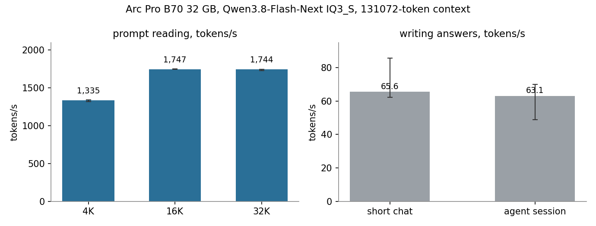
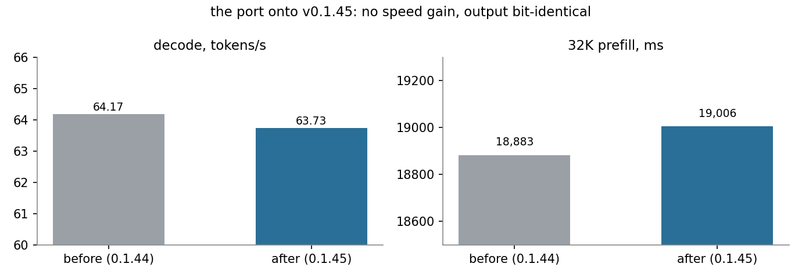

# Strata + Qwen3.8-Flash-Next on an Intel Arc Pro B70 32 GB — my fork

*mw-dev-private, October 2026.* A fork of [Strata](https://github.com/Niko1221/Strata) (MIT) with the SYCL work and the
settings I run every day to serve **Qwen3.8-Flash-Next (GSQ-RCO IQ3_S, 131072-token context)** on an **Intel Arc Pro
B70** behind a coding agent, a local assistant and an MCP client. Work done with OpenCode (Claude) as the coding
assistant; the direction, the hypotheses and the dead ends are mine.

**All the numbers on this page are mine, measured on this PC.** For Strata itself, its install and its own speed
tables see the [upstream README](https://github.com/Niko1221/Strata#readme) and, for the Intel port in general,
[docs/INTEL.md](docs/INTEL.md).

> [!IMPORTANT]
> **This fork is Intel Arc only, and it is only the B70.** Everything here is the Intel engine: the SYCL sources under
> `sycl/`, built with `-DSTRATA_ENABLE_SYCL=ON`, after which upstream's own CMake configures nothing else and stops
> the build outright if `STRATA_ENABLE_CUDA` or `STRATA_ENABLE_HIP` is set as well — the backends are mutually
> exclusive by design. So **no CUDA, no ROCm, no Metal/Mac, no multi-GPU, no Windows**: those paths are upstream's,
> they are untouched by this branch, never compiled by my build command, never run and never measured here.
> Within Intel: every change was written, compiled, tuned and measured on one card, the **Arc Pro B70 32 GB**
> (Battlemage, PCI device `8086:e223`, `xe` kernel driver). The box has a second Arc, an **Arc Pro B60**
> (`8086:e211`), which I use as a test card for kernel experiments and for an embedding backend — it is not the
> target of this branch and none of the numbers below were measured on it. Nothing is validated on an A-series Arc,
> an iGPU or any other Intel card. If your card is not a B70, treat this branch as untested and use upstream.

> [!NOTE]
> **Every speed number here is measured with the server at 131072 tokens of context**, the way I use it every day,
> thinking off and temperature 0, with Strata's own bench tool (`python tools/strata_bench.py --long --runs 3`).
> Upstream's published tables use 4K answers on 32K prompts. Context costs speed, and this machine's profile
> (13,423 cached experts out of 24,576) is not the profile of a 16 GB card.

## My PC

| | |
| --- | --- |
| **GPU (production)** | Intel Arc Pro B70, 32 GB, PCI `04:00.0`, device `8086:e223`, Battlemage, `xe` driver (`/dev/dri/renderD128`), Level Zero compute runtime 26.35.39758.10 |
| **GPU (test card)** | Intel Arc Pro B60, PCI `0b:00.0`, device `8086:e211` (`/dev/dri/renderD129`) — the card some kernel experiments ran on, and the card my embedding backend sits on. **No number on this page comes from it** |
| **CPU / RAM** | Intel Core i7-14700F, 123 GiB DDR4-3200 on an MSI B760 Gaming Plus WiFi DDR4 board |
| **System** | Linux, kernel 7.0.0-34-generic |
| **Compiler** | Intel oneAPI DPC++/C++ 2026.1.1 — `icx` and `icpx` both set explicitly |
| **Build gate** | `-DSTRATA_ENABLE_SYCL=ON`: only `sycl/` is configured, and upstream's CMake errors out if `STRATA_ENABLE_CUDA` or `STRATA_ENABLE_HIP` is also on |
| **Device code** | SPIR-V, JIT-compiled for the B70 at first start with a persistent cache (`SYCL_CACHE_PERSISTENT=1`, fixed `SYCL_CACHE_DIR`), device picked by `ONEAPI_DEVICE_SELECTOR=level_zero:0` — with two Arc cards in the box, the engine names what that selects: `GPU 0: Intel(R) Arc(TM) Pro B70 Graphics, compute capability 20.2`. `STRATA_SYCL_AOT` is deliberately **unset**; `-DSTRATA_SYCL_AOT=bmg-g31` is the Ahead-of-Time alternative and the only mode in which the GDN kernel gets its 256-GRF budget |
| **Model** | Qwen3.8-Flash-Next GSQ-RCO **IQ3_S** (two GGUF shards, the second passed as `--ple-gguf`) |
| **Engine** | Strata **v0.1.45** base (upstream `477ac13`) + this branch, one slot, no batch |
| **Runtime settings** | `--max-context 131072`, `--kv int8`, `--stream-experts`, `--expert-cache auto` (13,423 slots), `--prefill auto:32768`, `--spec 4 --spec-min-p 0.5`, MTP draft head, vision on, `--pcie-frac 0.35`, `--vram-reserve-mib 700` |

## How fast it runs here

Measured 2026-10-17 against the live server with Strata's own bench (median, range, n = 3 per prompt test):

| what | measured | notes |
| --- | --- | --- |
| **writes answers**, short chat | **65.6 tok/s** (62.3–85.6, n=9) | time to first token 0.48 s (0.44–0.53) |
| **reads a 4K prompt** | **1,335 tok/s** (1,321–1,343) | first token after 3.04 s |
| **reads a 16K prompt** | **1,747 tok/s** (1,746–1,752) | first token after 9.22 s |
| **reads a 32K prompt** | **1,744 tok/s** (1,730–1,750) | first token after 18.41 s |
| **an agent session** (15 follow-up turns) | **63.1 tok/s** decode (48.9–70.0) | first token 3.29 s (2.33–3.55), prompt-cache hit 68.7 %, only 4 tokens re-read per session (3–74) |
| first agent turn (nothing cached) | 2.14 s to first token | 609 tokens read |

Reading is flat at ~1,745 tok/s from 16K to 32K, but only ~1,335 tok/s at 4K: a short prompt pays a fixed
per-request cost of roughly 0.7 s, not a per-token cost. That is where this branch still loses time.

## Verified before it ran

The point of this branch is that the changes do not change the answers. On the same model, same learned expert
profile, same 13,423 cache slots, against the previous production binary:

- **346** Python server, prefix-encoder and compatibility tests pass.
- **248,320 logits per position, bit-identical**, at 64 forced continuation positions for each of three prompt
  fixtures (104 / 1,500 / 32,000 input ids); KL divergence **zero**.
- Kernel-level parity executables for each rewritten kernel (Q6_K/Q5_K/Q4_K decode unpack, QSA attention dispatch,
  the Intel delta stage), plus a bitwise slot-by-slot weight-refill check: **542 slots at 2K and 6,296 slots at 32K
  all equal**.

**No speed gain was established for the branch as a whole.** In a matched 32K-prompt + 256-token comparison
(three alternating pairs, production settings): decode 64.17 → 63.73 tok/s, prefill 18,883.0 → 19,005.7 ms — about
0.7 % slower decode and 0.6 % longer prefill. Individual pieces gained in their own measurement
(in-place Q6 head +1.3 % decode, asynchronous loan refill −29 % on the refill phase); the port's job was to carry
them onto v0.1.45 without changing output, and that is what it does.

## Tried, measured, thrown away

The part of the work that never made it in, with the measurement that ended it. Every row here was built and run,
then dropped rather than left behind a flag, so you don't spend an evening on it:

| attempt | what the measurement said |
| --- | --- |
| **ahead-of-time kernels for this card** (`-DSTRATA_SYCL_AOT=bmg-g31`) | identical token ids, and speed equal within noise: decode 64.2 / 64.7 AOT vs 63.5 / 65.4 JIT, 511-token pass 1,067 / 1,071 ms vs 1,078 / 1,085 ms, 16K prompt 896 vs 896 tok/s. AOT buys a ~3 % faster start and nothing else, so production stays on SPIR-V + JIT |
| **the grouped XMX GEMM for prefill experts** (`STRATA_PF_XMX=1`, and `=2` fused) | in a JIT build the flag is ignored on Battlemage, so it was measured in the AOT build: 511-token pass 1,207 ms (−13 %) and 16K 838 tok/s (−6 %) for `=1`; 1,064 ms (±0) and 880 tok/s (−1.7 %) for `=2`. Token ids identical in every variant — off |
| **XMX-armed attention in prefill** (`STRATA_PROMPT_ATTN_XMX=1`) | 16K prompt 686 / 695 tok/s against 889 / 887 without it: **−22 %**, and −26 % at a tile of 32 |
| **bypassing native-graph replay** (`STRATA_VERIFY_EAGER=1`) | decode 57.3 vs 63.8 tok/s: −10 % with identical token ids. Replay is the default here, and that 10 % is why |
| **BF16 (W4A16) weights for the dense projections** | correctness passed and token ids were identical, but the bench justified neither a production change nor a blanket rejection: the run was not resident, so allocation and transfer were mixed into the times. Not carried into production; the open question is a properly resident measurement, not another format search |
| **Intel's GDN delta-rule stage on the engine** (`STRATA_GDN_INTEL=1`) | kernel output exact, scratch reservation works, no engine-level win, and ~1 GB of device memory at a 16K chunk — built, off. Details in [sycl/README_gdn.md](sycl/README_gdn.md) |

And two that were tried on the **B60 test card**, which is reported only because the result is about how this
architecture behaves, not about B70 speed:

- **one fused expert kernel per (layer, expert)** — gate, SwiGLU, quantization and down in one kernel, staging through
  local memory: bit-exact against the 3-kernel path (58/58 parity pairs) and **6× slower per batch** (1,146 µs vs
  192 µs for 40 experts), 13.94 vs 15.89 tok/s end to end. The old path launches 200–800 work groups per kernel to
  hide DRAM latency; a fused kernel only launches ~40, and a Battlemage card with 57 execution units falls over there.
- **removing the int8 dot product** (`dp4a` → xor+add) across the quantized GEMV kernels: only Q4_K (20–29 %) and
  Q5_K (12–24 %) hang on it; Q6_K, Q8_0 and the IQ4 forms move 0 ± 5 %, and an explicit-SIMD Q4_K variant was
  **slower than the existing kernel despite bit-identical output**. Production runs Q6_K dense plus IQ3_S experts,
  which is almost entirely outside that ceiling.

More measured negatives, including the ones from the 0.1.44 line, are in [B70.md](B70.md).

## What is in this fork

- **[B70.md](B70.md)** — the whole flag reference: every `STRATA_*` variable this branch adds or uses, its default,
  when it is armed, what it measured, and what did **not** help (so you don't have to try it).
- **[sycl/README_gdn.md](sycl/README_gdn.md)** — Intel's GDN delta-rule stage on this card: build options, scratch
  reservation, the NaN poison audit, why it is built but **off** in my production.
- [sycl/README_q6_planes.md](sycl/README_q6_planes.md) — in-place Q6 head planes.
- [sycl/README_prefill_refill.md](sycl/README_prefill_refill.md) — asynchronous prefill loan refill.
- [bench/results/2026-10-17-b70-131k-charts/](bench/results/2026-10-17-b70-131k-charts/) — the two charts above as
  PNG, plus the table they come from and the command that produced it.

Everything is **opt-in by environment variable**. With the variables unset the engine behaves as upstream.
The delta to upstream v0.1.45 is 88 files: **79 of them under `sycl/`** (the Intel engine — including
`sycl/src/kernels/cuda/`, whose directory name is upstream's porting artifact: those are `.dp.cpp` SYCL device
sources compiled by `icpx` for Intel, not NVIDIA code), 3 in `serve/` (one compatibility setting, explained in
B70.md), 2 shared headers (`include/strata/kernels/qsa_decode_attn.hpp`, `include/strata/prefill/kernels.hpp`),
one test, one bench tool and these documents. **Nothing under `src/`, `metal/`, `hip/` or the engine's CUDA
directories is touched.**

Branches: `main` and `v0145-b70-sycl-fast` both carry the line I run, on upstream v0.1.45 (`477ac13`); the older
0.1.44 line it replaces is kept privately for rollback. This fork is where the work happens — no pull requests
upstream.

Speeds depend on the card, the RAM and the kind of text: these are one PC's numbers, not a promise. Nothing here was
tested for multi-GPU, long stability or vision throughput.

License: MIT, as upstream.
